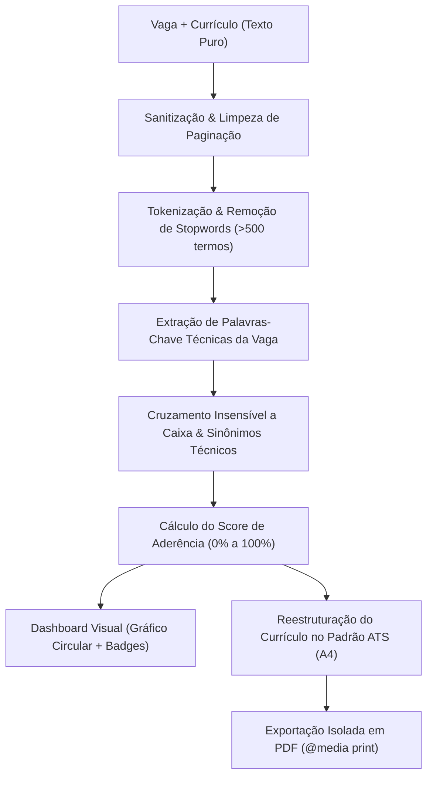

# ATS Matcher — Otimizador Ético de Currículos para Sistemas ATS

> **🚀 Aplicação Publicada:** [Acesse o ATS Matcher ao vivo aqui](https://projectagent.github.io/ATS-Matcher)  
> **Repositório GitHub:** [https://github.com/projectagent/ATS-Matcher](https://github.com/projectagent/ATS-Matcher)

---

## 🎯 1. Qual problema a aplicação resolve?

Sistemas de Rastreamento de Candidatos (*Applicant Tracking Systems* - **ATS**), tais como **Workday, Greenhouse, Lever, Taleo e Gupy**, são amplamente utilizados por empresas para filtrar automaticamente currículos antes mesmo de qualquer triagem humana. Estima-se que mais de **75% dos currículos sejam descartados nessa primeira etapa** devido a dois problemas fundamentais:

1. **Incompatibilidade de Palavras-Chave:** O candidato possui as competências necessárias, mas utilizou termos diferentes ou omitiu menções explícitas às tecnologias e metodologias centrais exigidas pela vaga.
2. **Formatações Complexas que Quebram Parsers:** Modelos visuais com múltiplas colunas, gráficos de barra de habilidades, ícones, caixas de texto flutuantes e tabelas confundem os algoritmos de leitura ótica e textual dos ATS, gerando texto truncado ou ilegível.

O **ATS Matcher** resolve esse gargalo ao permitir que o profissional cruze a descrição da vaga com o seu currículo em tempo real, gerando:
- Um **Match Score de 0% a 100%** com base na aderência técnica real.
- Um **Dashboard de Diagnóstico** indicando palavras-chave encontradas e faltantes.
- Uma **Versão Estruturada ATS-Friendly** em folha A4 limpa e padronizada, pronta para exportação em PDF.

> ⚖️ **A REGRA DE OURO:** A aplicação otimiza a legibilidade e a distribuição das informações para robôs ATS, mas **NUNCA inventa experiências ou competências que o candidato não possui**.

---

## 🚀 2. Mega Prompt Utilizado e sua Evolução

O projeto foi construído utilizando engenharia de prompts iterativa em Markdown, concebido para execução em ferramentas de IA Generativa de código (como Lovable, Antigravity e Claude Code).

### 📝 O Mega Prompt Inicial

```markdown
# ATS Matcher — Prompt de Construção (MVP)

Construir uma Single Page Application em React, TypeScript e Tailwind CSS inspirada no design system shadcn/ui.

## Paleta de Cores e Identidade Visual (Clean & Profissional)
- Fundo da Aplicação: Slate Claro (bg-slate-50 / bg-slate-100)
- Superfícies de Cards: Branco Puro (bg-white) com bordas sutis (border-slate-200) e sombras leves (shadow-xs/shadow-sm)
- Ações Primárias: Azul Marinho / Indigo Profundo (bg-indigo-600 hover:bg-indigo-700)
- Alertas e Badges de Sucesso: Verde Esmeralda Pastel (bg-emerald-50 text-emerald-800 border-emerald-200)
- Alertas e Badges de Ausência: Vermelho / Rose Pastel (bg-rose-50 text-rose-800 border-rose-200)
- Aviso de Ética (Regra de Ouro): Âmbar Suave (bg-amber-50 text-amber-900 border-amber-200)
- Tipografia: Inter / System Sans-serif limpa e altamente legível.

## Estrutura da Interface (UI/UX)
1. Header:
   - Logótipo "ATS Matcher" com tag "MVP".
   - Alerta visual com a REGRA DE OURO: "Atenção: A aplicação otimiza a estrutura para ATS, mas NUNCA inventa experiências ou competências que não possui."
2. Área de Input (Split Screen):
   - Dois textareas lado a lado em desktop (empilhados em mobile): "Descrição da Vaga" e "Currículo Atual".
   - Contadores em tempo real de palavras e caracteres.
   - Botões de apoio: "Carregar Exemplo" e "Limpar".
   - Botão central com loading state: "Analisar e Otimizar para ATS".
3. Resultados do Match (Dashboard):
   - Progress bar circular em SVG com Match Score dinâmico (0% a 100%).
   - Badges verdes com as "Palavras-chave Encontradas".
   - Badges vermelhos com as "Palavras-chave Faltantes".
4. Visualizador do Currículo Otimizado (Folha A4):
   - Simulação de folha A4 com fundo branco e tipografia Inter.
   - Seções padronizadas: Cabeçalho, Resumo Profissional, Competências Técnicas, Experiência e Educação.
5. Exportação:
   - Botão "Baixar como PDF" utilizando @media print para isolar exclusivamente a folha A4.
   - Botão "Copiar Texto ATS".
```

### 🔄 O que mudou do Prompt Inicial até a Versão Final?

Durante o desenvolvimento e testes com currículos reais, foram identificadas e corrigidas necessidades críticas:
1. **Sanitização de Resíduos de PDF:** Inclusão de regex para remoção de cabeçalhos e rodapés de paginação que vinham grudados ao copiar o texto de PDFs originais.
2. **Higienização do Documento A4:** Inicialmente, badges e caixas coloridas estavam sendo renderizadas na folha A4. Na versão final, todas as decorações visuais foram restritas ao Dashboard, tornando o documento A4 100% puro texto estruturado.
3. **Expansão Léxica de Stopwords:** A lista inicial de stopwords comuns deixava passar jargões corporativos e verbos vazios como se fossem tecnologias exigidas. A versão final incorporou um dicionário com mais de 500 stopwords e heurística léxica para termos técnicos compostos.

---

## ⚙️ 3. Como a análise funciona (Passo a Passo)



1. **Entrada de Dados:** O utilizador insere a descrição da vaga e o seu currículo atual nos blocos de entrada.
2. **Sanitização do Texto:** Expressões regulares inspecionam o currículo e removem rodapés como `"Page 1 of 2"`, `"Página 2 de 3"`, `- 1 -` e separadores de impressão, preservando datas e números reais (ex: `"5 anos de experiência"`).
3. **Extração Inteligente de Palavras-chave:** 
   - O algoritmo divide o texto da vaga, preservando termos pontuados (`Node.js`, `C++`, `C#`) e compostos (`CI/CD`, `UI/UX`, `Tailwind CSS`).
   - Remove mais de 500 stopwords em português e inglês (verbos genéricos, pronomes, artigos, preposições e jargões corporativos).
4. **Matching & Cálculo do Score:**
   - Compara as palavras-chave extraídas da vaga com o texto do currículo, aplicando insensibilidade a acentos e maiúsculas/minúsculas.
   - Resolve sinônimos e variações técnicas (ex: `React.js` ↔ `React`).
   - Calcula o índice percentual de cobertura dos requisitos.
5. **Apresentação no Dashboard:** O usuário visualiza o gráfico circular (*progress ring*) colorido dinamicamente conforme o nível de aderência ($\ge 75\%$ verde, $50-74\%$ âmbar, $<50\%$ vermelho) e as listas de termos encontrados vs. faltantes.
6. **Formatação A4 e Exportação:** O currículo é reorganizado em seções hierárquicas claras (Resumo, Competências em lista limpa, Experiências cronológicas e Formação). O botão *"Baixar como PDF"* aciona uma regra CSS `@media print` que remove toda a interface gráfica do navegador e gera um PDF contendo estritamente a página A4.

---

## 🛠️ 4. Ajustes Solicitados após a Primeira Geração (e Por Quê)

Após o primeiro ciclo de geração, foram refinados três aspectos essenciais:

| # | Ajuste Solicitado | Motivação Técnica |
|---|-------------------|-------------------|
| **1** | **Filtro de Artefatos de Paginação** | Ao copiar currículos de arquivos PDF existentes, resíduos como `"Page 2 of 3"` ou `"Pág. 1"` eram interpretados pelo parser como tópicos de experiência ou habilidades. O filtro regex eliminou esse ruído na origem. |
| **2** | **Remoção de UI da Folha A4** | A primeira versão exibia badges coloridas com fundo verde e tags `<mark>` dentro da folha A4. Embora visualmente agradáveis para humanos, tags HTML e fundos coloridos podem confundir os parsers OCR de sistemas como o Taleo e o Workday. A folha A4 foi convertida para texto puro e estruturado com tipografia limpa. |
| **3** | **Filtro de Stopwords e Verbos Genéricos** | Palavras comuns de anúncios de vagas (ex: *"vontade"*, *"regras"*, *"funcionamento"*, *"forma"*, *"aplicá-los"*, *"pessoais"*) estavam sendo extraídas como palavras-chave técnicas e aparecendo como requisitos faltantes. A expansão de mais de 500 stopwords garantiu que o score meça exclusivamente competências e tecnologias reais. |

---

## 💡 5. Ideias para Evolução Futura

- [ ] **Exportação em formato `.docx`:** Para permitir que o candidato faça edições manuais personalizadas antes do envio final.
- [ ] **Persistência de Histórico (Banco de Dados):** Armazenamento das vagas analisadas e do histórico de evolução do Match Score.
- [ ] **Autenticação e Notificações:** Sistema de login com envio de relatórios comparativos por e-mail (usando Resend).
- [ ] **Especialização por Nicho:** Dicionários adaptados para vagas jurídicas, financeiras, saúde ou primeiro emprego / estágio.
- [ ] **Otimização GEO (Generative Engine Optimization):** Preparar o currículo com semântica otimizada para triagens feitas por modelos de LLM (ChatGPT Enterprise, Claude for Work, Microsoft Copilot).

---

## 🧪 6. Tecnologias Utilizadas & Verificação

- **Framework:** React 19 + TypeScript + Vite
- **Estilização:** Tailwind CSS v4 (Padrão shadcn/ui)
- **Ícones:** Lucide React
- **Testes Automatizados:** Vitest (50 testes unitários cobrindo sanitização, parsing, matching e renderização)
- **Linter:** Oxlint (0 erros e 0 avisos em 20 arquivos)
- **Deploy:** GitHub Actions + GitHub Pages (`gh-pages`)

```bash
# Rodar testes unitários
npm run test

# Executar linter
npm run lint

# Compilar para produção
npm run build
```

---

## 📸 Evidências Visuais e Telas

- 
- 
- 
